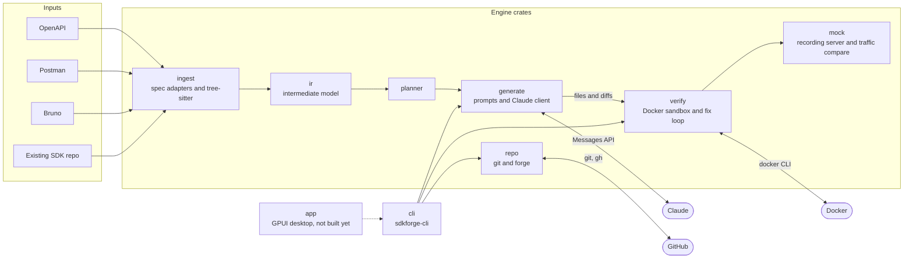
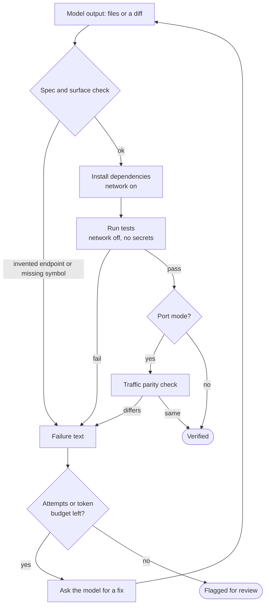
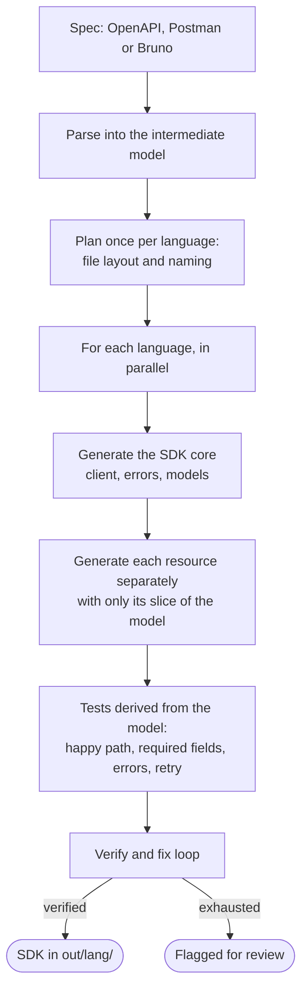
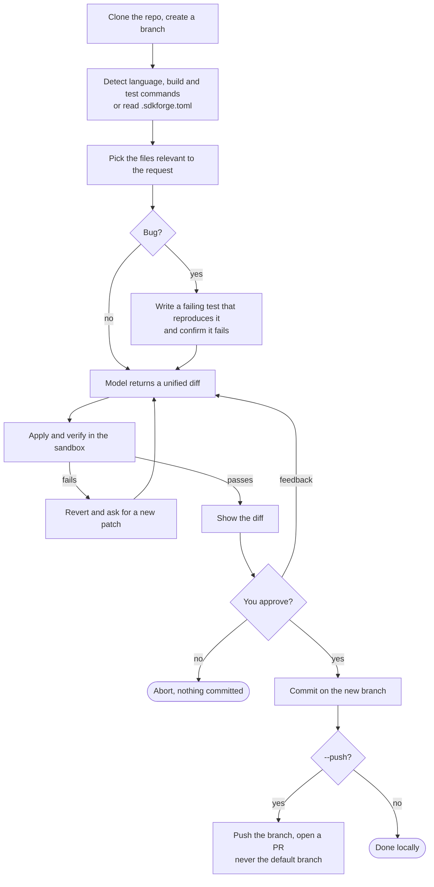
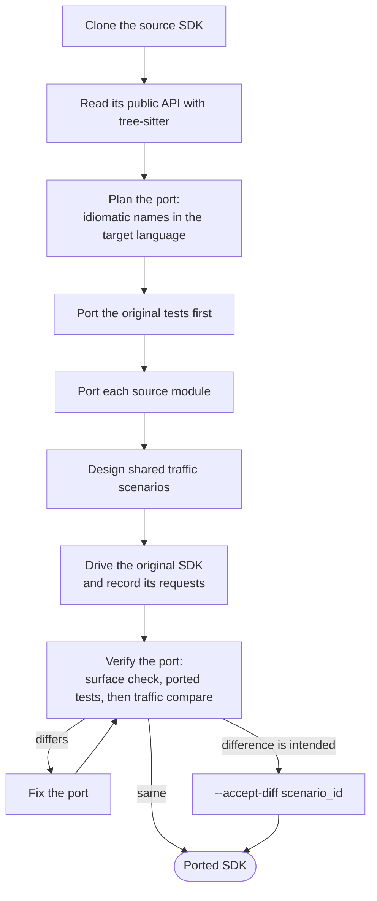
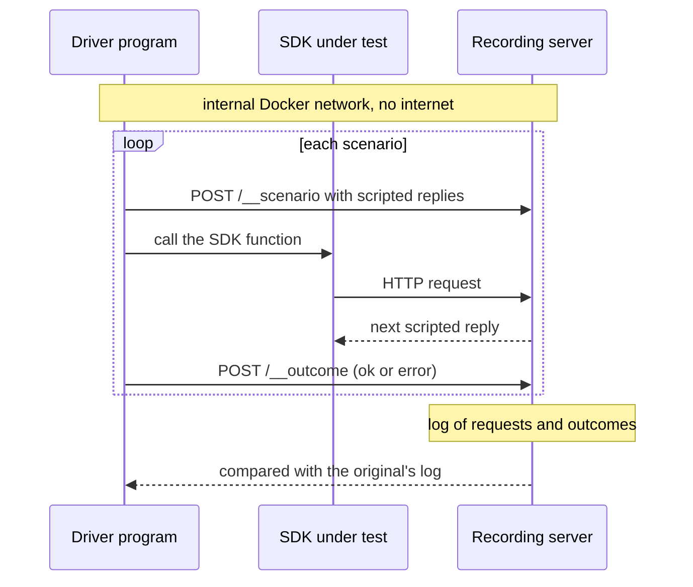

# SDK Forge

A Rust tool that uses Claude to build, maintain and port API client SDKs, and proves every result by
building and testing it in a Docker sandbox before you see it.

Nothing ships on the model's word alone: parse deterministically, let the model write code, then verify
by running tests in a sandbox and feeding failures back until they pass (or a retry and token cap is hit).

| Mode | Input | Output |
| --- | --- | --- |
| **Generate** | OpenAPI, Postman collection or Bruno folder, plus free-text instructions | A tested SDK in one or more languages |
| **Maintain** | An existing SDK repo plus an error message or improvement | A verified patch on a new branch, optionally pushed with a PR |
| **Port** | An existing SDK repo in one language | The same SDK rebuilt idiomatically in another, with the original's tests ported first |

Languages: Python, Node, PHP, Rust and Go. All five can be a Generate or Port target, and all five can be a Port source.

## Requirements

- Rust (to build), Docker (every build and test runs in a container), `git`.
- `ANTHROPIC_API_KEY` in your environment. Keys are never written to disk and never passed into a sandbox.
- `gh` (GitHub CLI), only for `maintain --push`.

```
cargo build --release          # binary: target/release/sdkforge-cli
```

## Usage

```
# Generate: one language, or several in parallel into out/<lang>/
sdkforge-cli generate examples/petstore-mini.yaml -l python -o out -i "async-first"
sdkforge-cli generate examples/postman-mini.json -l python,node,php,rust,go -o out
sdkforge-cli generate examples/bruno-pets -l go --dry-run         # parse and plan only, no model calls

# Maintain: patch a repo, review the diff, commit to a new branch
sdkforge-cli maintain ./some-sdk -r "paginate stops early on an empty cursor" --bug
sdkforge-cli maintain https://github.com/acme/sdk -r "add retry on 503" --push   # push + open a PR

# Port: rebuild an SDK in another language
sdkforge-cli port https://github.com/acme/sdk-node --to rust -o port-out
sdkforge-cli port ./sdk-go --to php --accept-diff send_standard_happy_path       # accept a known behaviour difference
```

Useful flags: `--max-attempts` and `--token-budget` cap the fix loop; `--model` picks the Claude model;
`--no-parity` skips the traffic check in Port; `--from` sets the Port source language when it can't be detected.

## How it works

### Architecture

The model never touches your machine directly. Deterministic crates parse and plan, the model only writes
code, and Docker runs everything it wrote.



### The verify and fix loop

Every mode ends in the same loop. A failure is fed back to the model; after the attempt cap or token
budget the run is flagged for review instead of shipped.



### Generate



Test cases are derived mechanically from the model rather than left to the model's imagination, and the
fidelity check rejects any API path in the generated code that is not in the spec.

### Maintain



### Port

The original's tests are ported first and define correct behaviour; a recorded-traffic comparison then
checks that the port sends the same HTTP requests as the original.



### Traffic parity

Both SDKs are driven through the same scripted scenarios against a recording server on a Docker network
with no internet access. The recorded requests are compared one by one.



## Safety rules

- Builds and tests run only inside Docker containers, never on your machine.
- API keys and Git tokens never enter a container. Tests run with the network off after dependency install.
- Credential-looking values are redacted from your instructions and from error output before they reach the model.
- Maintain never pushes the default branch, and nothing is committed until you approve the diff.
- The fix loop has an attempt cap and a token budget, so a stuck run cannot spend without limit.
- Generated file paths that try to escape the output folder are dropped.

## Project layout

```
crates/
  ir/        intermediate model
  ingest/    OpenAPI, Postman and Bruno adapters; tree-sitter source analysis
  planner/   per-language file layout and naming
  generate/  prompts, Claude client, file parsing, redaction, fidelity check
  verify/    Docker sandbox, toolchains per language, fix loop, traffic recording
  mock/      recording server and traffic comparison
  repo/      git operations and forge providers
  cli/       sdkforge-cli
  app/       GPUI desktop app (placeholder)
examples/    sample specs
```

## Status

Generate, Maintain and Port work end to end from the command line. The desktop app and several delivery
features are not built yet; see [WHATS_LEFT.md](WHATS_LEFT.md).
